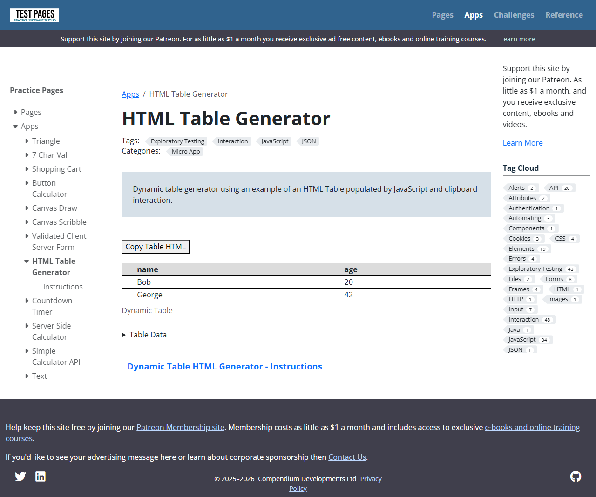
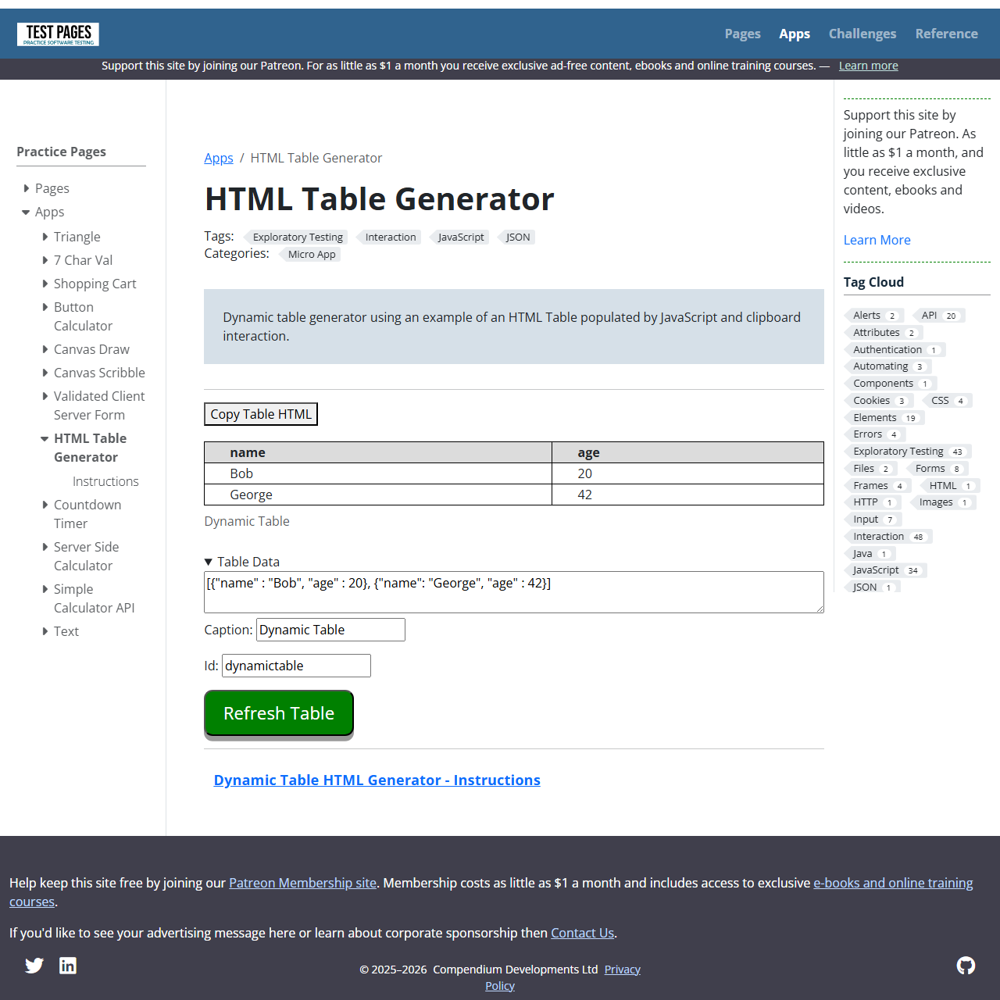
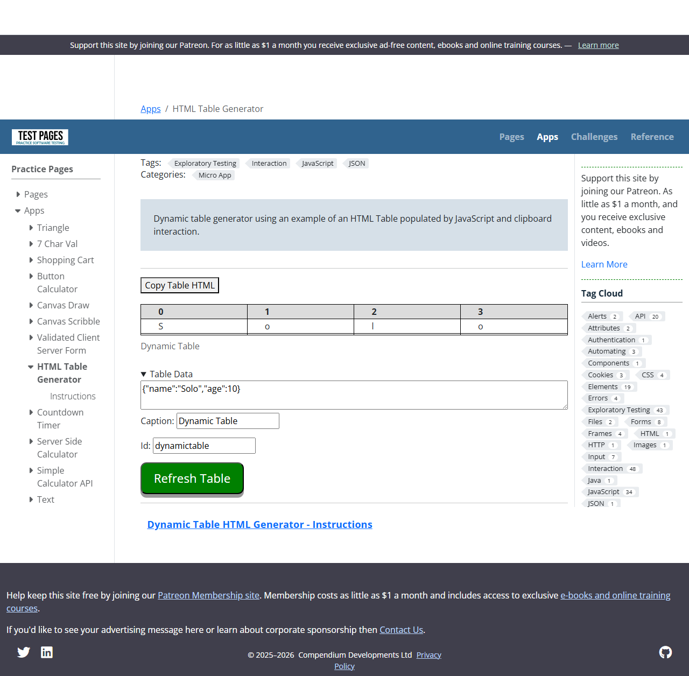
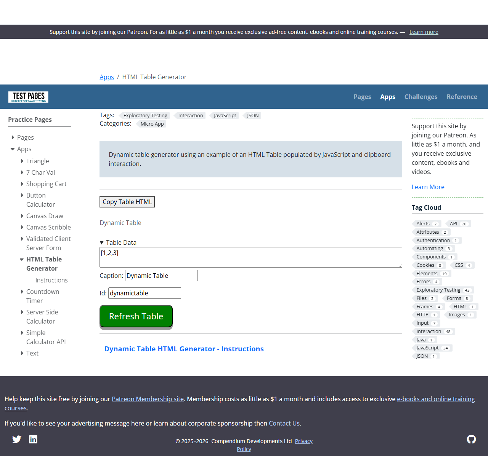
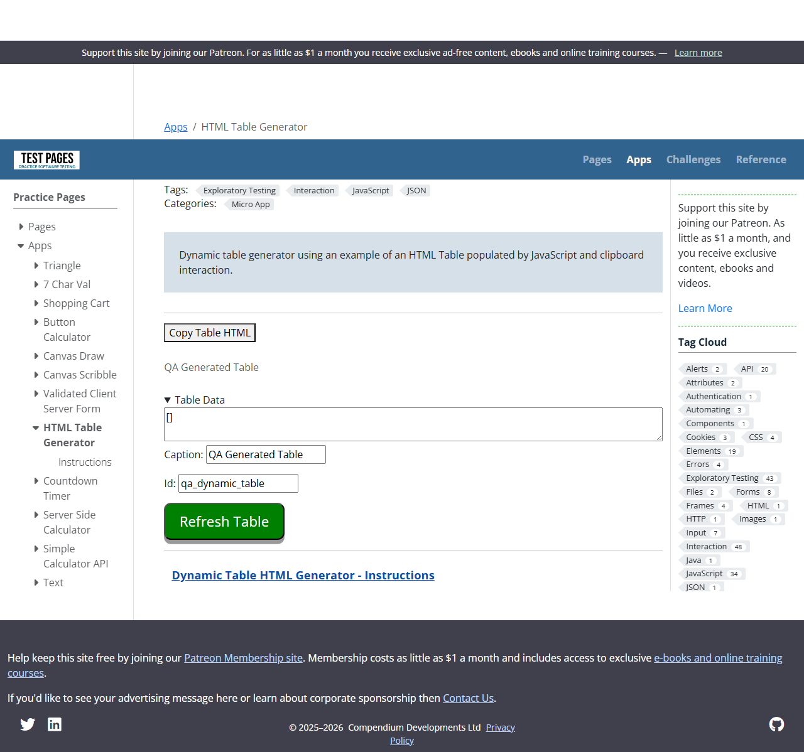

# 20260307 13:35
Starting exploratory testing using Playwright on https://testpages.eviltester.com/apps/html-table-generator/ only.
Focus areas: baseline rendering, Table Data editor behavior, JSON input handling, caption/id updates, and copy HTML functionality.

# 20260307 13:36
Observed initial page state and captured evidence.
- Default table rendered with caption `Dynamic Table` and rows for Bob/George.
- `Table Data` editor is collapsed by default under a details element.

# 20260307 13:37
Expanded `Table Data` and exercised happy path with valid JSON array of row objects.
Input used:
`[{"name":"Alice","age":31,"city":"Leeds"},{"name":"Ben","age":28,"city":"York"}]`
Observed:
- Table refreshed with 2 rows and added `city` column.
- No page errors.

# 20260307 13:38
Updated caption and table id then refreshed.
Observed:
- Caption changed to `QA Generated Table`.
- Table id changed to `qa_dynamic_table`.
- Data remained intact.

# 20260307 13:39
Tested malformed JSON handling.
Input used:
`[{"name": "Broken", "age": 99}`
Observed:
- JavaScript page error thrown: `SyntaxError: Expected ',' or ']' after array element...`
- Existing table remains unchanged.
- No user-facing validation/help message shown on page.

# 20260307 13:40
Tested edge input shapes against stated expected format (array of row objects with name/age).
- Non-array object input: `{"name":"Solo","age":10}` produced column headers `0,1,2,3` and split `Solo` into separate cell characters.
- Array of numbers input: `[1,2,3]` produced empty rows with no headers.

# 20260307 13:41
Tested empty array input and copy action.
- Empty array `[]` refresh cleared rows (table remains present).
- `Copy Table HTML` action verified by stubbing clipboard write in page context; table HTML string was produced.
- Direct clipboard read/write under headless automation is permission-restricted, so clipboard OS-level verification was not used as pass/fail evidence.

# BUG: malformed JSON is not handled gracefully

Issue:
Entering invalid JSON causes an uncaught JavaScript exception and provides no user-facing validation message.

When:
1. Expand `Table Data`
2. Enter malformed JSON into `jsondata`
3. Click refresh button

Observed:
`SyntaxError` is thrown; table silently remains on old data.
Expected: clear inline validation feedback, with no uncaught error.

Notes:
Evidence in `screenshot_invalid_json_attempt.png` and `playwright_results.json` pageErrors.

# BUG: input type validation missing for JSON root/object shape

Issue:
Inputs outside expected schema (`array of row objects`) are accepted and rendered into misleading table output.

When:
1. Enter non-array JSON object `{"name":"Solo","age":10}` and refresh
2. Enter array of primitives `[1,2,3]` and refresh

Observed:
- Non-array object renders character-split cell output with numeric headers.
- Primitive array renders blank rows/headers.
Expected: reject unsupported shapes with validation error.

Notes:
Evidence in `screenshot_non_array_object_input.png` and `screenshot_array_of_numbers_input.png`.
